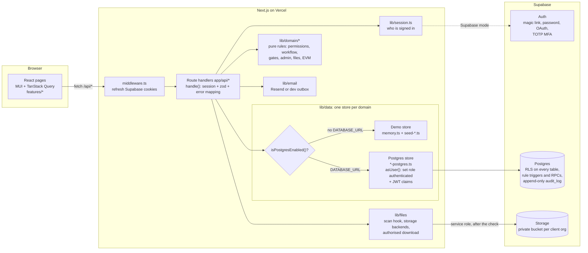

# Architecture

Konnect Hub is one Next.js (App Router) application. Konnector staff use the internal app (`app/(internal)`, dark theme); client users use the portal (`app/portal`, light theme). Both read and write through the same route handlers and the same data layer, so a rule is written once and holds everywhere.

## Request flow

1. The browser calls a route handler (`/api/...`) with TanStack Query. Pages are thin client components in `features/<domain>`.
2. `handle()` (`lib/api.ts`) resolves the session (`lib/session.ts`): the Supabase user in production (with the MFA and session-age rules), or the demo persona cookie. It validates the body with zod and maps domain errors to 400 / 401 / 403 / 404.
3. The handler calls a **store** function with the session, e.g. `attachmentStore().get(session, id)`.
4. The store applies the domain rules and reads or writes data. Every write that matters is audited.
5. Side effects that must not happen for a rolled-back write (emails, real-time events) run after commit.

## Stores: one interface, two implementations

Every domain (`Repo` for projects/items/comments, then RAID, sprints, gates, deliverables, insight, metrics, reports, signal, capacity, ledger, audit, workspace, admin, templates, custom fields, attachments) has:

| Piece                  | File pattern                    | Purpose                                                                                                   |
| ---------------------- | ------------------------------- | --------------------------------------------------------------------------------------------------------- |
| Interface + demo store | `lib/data/<domain>.ts`          | In-memory implementation over `db()` (the seeded `Db` from `lib/data/seed.ts`).                           |
| Postgres store         | `lib/data/<domain>-postgres.ts` | Same interface over Postgres; RLS is the enforcer.                                                        |
| Selector               | `<domain>Store()`               | `isPostgresEnabled()` (DATABASE_URL + `KH_DATA=postgres` or Supabase) picks Postgres.                     |
| Contract suite         | `lib/data/contract-<domain>.ts` | The same scenarios run against both stores (`npm test` for memory, `run-contract-tests.sh` for Postgres). |

The demo store re-implements the access rules in TypeScript (`lib/domain/permissions.ts`: `canSeeProject`, `canSeeVisibility`…). The Postgres store does **not** re-filter rows: each call runs in one transaction as the user (`asUser()`: `set local role authenticated` plus `request.jwt.claim.sub`), so the policies decide what exists. The contract suites keep the two in step.

## Row Level Security

- Every table in `public` has RLS enabled and at least one policy (test 1 of `supabase/tests/rls.test.sql` fails otherwise). `anon` has no table access.
- **Tenant isolation:** policies filter by `visible_project_ids()`; a client user sees only projects of their own organization. The RLS suite proves a client of Org A gets zero rows of Org B in every table with a `project_id`.
- **Internal vs shared:** rows with `visibility = 'internal'` (items, comments, attachments, RAID, deliverables, reports, activity, custom fields) are invisible to client roles. Children follow their parent: a shared comment or file on an internal item, or a file on an internal comment, stays hidden.
- **Rules no client can bypass** live in the database: only `transition_work_item()` sets Accepted (client roles, or a Lead with an offline note), gate decisions need a fresh re-auth, budgets and cost rates sit in Admin/Lead-only tables, roles must match the organization type, and `audit_log` rejects updates and deletes.
- **Deactivated users** have no role (`current_profile_role()` returns null), so every policy denies them.

## Files

Uploads go to `POST /api/attachments` (multipart). The route checks the size (25 MB) and type allow-list, runs the virus-scan hook (`lib/files/scan.ts`, a placeholder that passes until a real scanner is installed), then the attachment store checks the caller may attach to that item, comment or RAID entry and records the row while the bytes are written (a failed write records nothing). Bytes live in a private bucket per client organization. Downloads only go through `GET /api/attachments/:id/download`, which repeats the visibility check and then returns a 5-minute signed URL (Supabase) or streams the bytes (demo and local Postgres).

## Audit

`audit_log` is append-only and records who, what, when and from where: the app passes the validated client IP to the transaction (`kh.client_ip`) and a trigger stores it on every audit row. Permission changes (roles, memberships, deactivation) are audited by triggers, so they are recorded even if a future code path forgets. Admins read the log at `/admin/audit`.

## Real time and email

Real-time board updates use an in-process bus with Server-Sent Events (`lib/realtime`); in production Supabase Realtime takes over. Email goes through Resend when `RESEND_API_KEY` is set, otherwise into the dev outbox (`/api/dev/outbox`).
